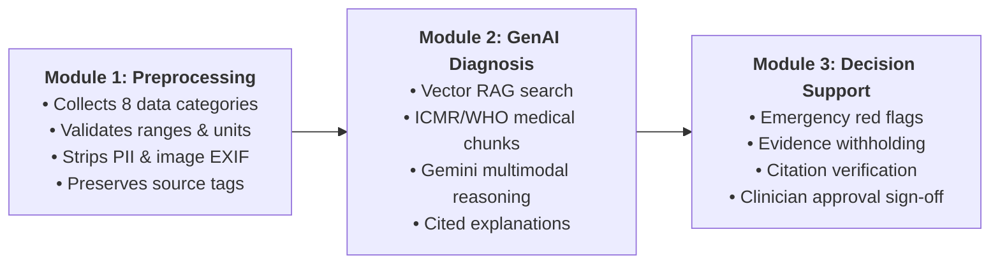

# MED-AI — Project Handover & Evaluation Guide

**Project Code:** 27CSPS028  
**Official Project Title:** Reimagining Healthcare with Generative AI: Personalized Diagnosis and Treatment  
**System Name:** MED-AI  
**Domain:** Healthcare — Clinical Decision Support System (CDSS)  

---

## 1. Quick Start: How to Run the Project on Any Machine

If you are evaluating or running this project for the first time on a cloned machine, follow these simple steps:

### Step 1: Prerequisites
Make sure your system has:
1. **Python 3.11+** (Check "Add Python to PATH" during installation)
2. **Node.js 18+ or 20+** (Includes `npm`)

### Step 2: Configure Environment (`backend/.env`)
1. In the `backend/` folder, find `backend/.env.example`.
2. Copy or rename it to `backend/.env`.
3. Paste the actual **`DATABASE_URL`** and **`GEMINI_API_KEY`** shared with you.
   *(The template is pre-configured with the correct cloud host, SSL flags, and model name `gemini-3.5-flash-lite`).*

### Step 3: Run the Setup Script
From the project root folder, double-click:
```cmd
setup.bat
```
*(This automatically creates the Python `.venv`, installs all packages from `requirements.txt`, applies database migrations, and installs frontend `npm` packages).*

### Step 4: Start the System
Whenever you want to start the project, double-click:
```cmd
start_app.bat
```
- It starts the **FastAPI Backend** (`http://127.0.0.1:8000`) in one window.
- It starts the **React Frontend** (`http://localhost:5173`) in a second window.
- It **automatically opens your web browser** to the application homepage!

---

## 2. What This Project Is (In Simple Words)

In traditional clinics, a doctor has to manually read through separate things:
1. What the patient feels (symptoms, cough, fever).
2. Physical numbers (Blood pressure, Heart rate, $\text{SpO}_2$ oxygen level).
3. Blood tests (WBC, CRP, glucose).
4. Old doctor letters or discharge PDFs.
5. X-ray scans.

Connecting all these dots takes time. **MED-AI is an intelligent Clinical Decision Support System (CDSS) built to assist healthcare professionals.** It acts like an expert medical research assistant that:
- Reads all these multimodal data points together.
- Cleans and de-identifies the data for privacy.
- Searches verified medical guidelines (WHO, ICMR, NHS, NIH).
- Highlights abnormal vitals against standard adult ranges.
- Suggests evidence-grounded differential conditions with direct citations.
- Flags emergency red flags immediately.
- Gives the clinician a place to review, write notes, and approve the analysis.

> **Crucial Rule:** MED-AI **does not replace the doctor** and **does not prescribe medicines**. It assists the doctor with transparent, evidence-backed explanations.

---

## 3. The 3 Core Modules (How It Works Internally)

The project is built around the three official project modules:



### Module 1: Data Analysis & Preprocessing
- Accepts up to 8 categories of healthcare data:
  1. Patient Demographics (Age, sex, patient code).
  2. Symptoms & duration (e.g., productive cough for 4 days).
  3. Medical history & medications (allergies, paracetamol).
  4. Clinical measurements (BP, Heart Rate, Temperature, $\text{SpO}_2$).
  5. Laboratory results (WBC count, CRP level).
  6. Clinical notes & documents (PDF/TXT reports).
  7. Medical images (Chest X-rays).
  8. Optional genomic / family history notes.
- **Privacy & Sanitization**:
  - Automatically scrubs patient names, phone numbers, and emails.
  - Automatically strips camera/GPS EXIF metadata from uploaded images.
  - Clearly labels each piece of data by its origin (`Patient-reported`, `Manually entered`, `Laboratory results`, etc.).

### Module 2: Generative AI-Based Diagnosis
- **Retrieval-Augmented Generation (RAG)**: The system doesn't "hallucinate" or guess from generic memory. It searches a built-in library of **12 official medical guidelines** (ICMR, WHO, NIH, NHS with 291 indexed chunks in PostgreSQL).
- **Gemini Multimodal Reasoning (`gemini-3.5-flash-lite`)**: Takes the de-identified patient data + X-ray image + retrieved medical guidelines and outputs:
  - Concise patient summary.
  - Individual finding cards comparing vitals against standard adult ranges.
  - Potential diagnostic considerations with direct chunk citations.
  - Questions and tests for the doctor to discuss with the patient.

### Module 3: Decision Support & Privacy Safeguards
- **Emergency Screening**: If life-threatening signs appear (e.g., severe chest pain or $\text{SpO}_2 < 90\%$), it triggers high-visibility red emergency warnings.
- **Treatment Guidance Withholding**: If the library has no strong verified guidelines matching the patient's condition, the AI **suppresses** treatment suggestions instead of making things up.
- **Clinician Review & Sign-Off**: The report stays marked `Pending Review` until a licensed doctor enters their notes and clicks **Save Review**.

---

## 4. How to Demonstrate the Project in 3 Minutes

When presenting or handing over this project, walk through this exact 4-step sequence:

### Step 1: Open the Dashboard (Overview)
- Start with `http://localhost:5173`.
- Point out the **Patient Records** table showing saved patients, their recorded vitals, and review statuses (`Pending Review` vs `Reviewed`).

### Step 2: Show the Knowledge Base (Evidence Grounding)
- Click **Knowledge Base** in the top navigation.
- Show the 12 verified medical guidelines (ICMR Respiratory, ICMR Cardiology, WHO Pulse Oximetry, NHS CRP, MedlinePlus WBC).
- Explain: *"This ensures the AI does not hallucinate; it only generates insights backed by official medical guidelines."*

### Step 3: Run a New Healthcare Analysis
- Click **New Analysis**.
- Select or create a patient.
- Enter sample respiratory vitals:
  - Symptoms: `Fever, productive cough with yellowish sputum, chest discomfort`
  - Duration: `4 days`
  - Temperature: `38.6 °C`
  - Heart Rate: `104 bpm`
  - $\text{SpO}_2$: `93%` (flagged as low)
  - Labs: `WBC 14,200 cells/µL, CRP 68 mg/L`
  - Upload a chest X-ray image (PNG or JPG).
- Click **Save & Continue to Diagnostic Output**.

### Step 4: Show the Generated Output & Clinician Sign-Off
- Click **Generate Diagnostic Output** (generates in ~15 seconds).
- Show the **Finding Cards**: Point out that the system explains *what* the measurement means, *why* $\text{SpO}_2$ 93% or CRP 68 mg/L is outside typical adult limits, and *cites* the ICMR / WHO guidelines.
- Show **Section 07 (Medical Image Observations)**: Point out how the X-ray was analyzed alongside the vitals.
- Scroll to **Section 08 (Clinician Review & Approval)**: Type a short doctor note (e.g., *"Correlates with auscultation; initiate workup"*) and click **Mark as Reviewed**.
- Show that the report status immediately flips to **Report Reviewed**.

---

## 5. Technology Stack Summary

| Layer | Technologies | Purpose |
|---|---|---|
| **Frontend** | React 19, TypeScript, Vite, CSS design tokens | Responsive, modern clinical dashboard |
| **Backend** | Python 3.11, FastAPI, Pydantic v2, Uvicorn | High-performance asynchronous REST API |
| **Database** | PostgreSQL (Aiven Cloud / Docker Compose) | Relational storage for patients, assessments, reports, and knowledge chunks |
| **AI / RAG** | Google GenAI SDK (`gemini-3.5-flash-lite`, `gemini-embedding-001`) | Fast, structured clinical reasoning & vector embeddings |
| **Multimodal Processing** | `pypdf`, `Pillow` (PIL) | PDF report text extraction & EXIF metadata stripping |
| **Database Migrations** | Alembic | Version-controlled schema management (`20261112_0004`) |
