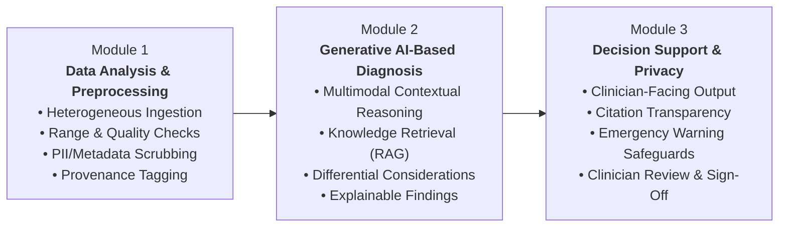
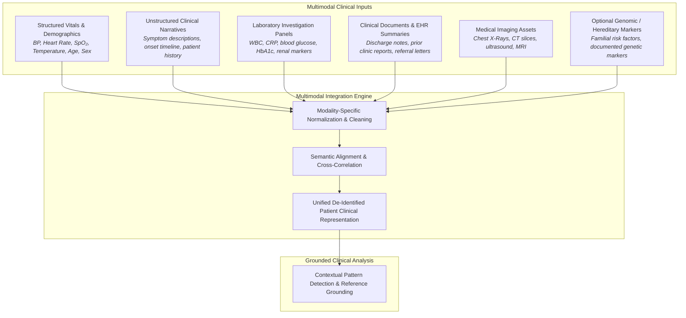
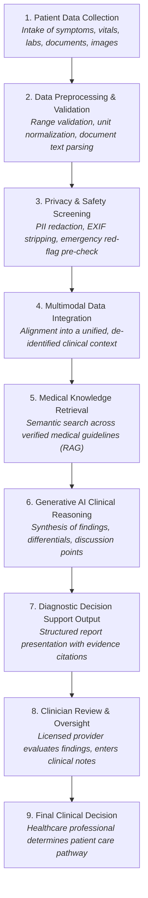

# MED-AI: Personalized Healthcare Decision Support System

**Project Code:** 27CSPS028  
**Official Project Title:** Reimagining Healthcare with Generative AI: Personalized Diagnosis and Treatment  
**System Name:** MED-AI  
**Domain:** Healthcare — Clinical Decision Support System (CDSS)  

---

## Table of Contents

- [1. Executive Summary](#1-executive-summary)
- [2. Problem Statement](#2-problem-statement)
- [3. Project Objectives](#3-project-objectives)
- [4. Proposed System Architecture](#4-proposed-system-architecture)
- [5. Core Project Modules](#5-core-project-modules)
  - [Module 1: Data Analysis and Preprocessing](#module-1-data-analysis-and-preprocessing)
  - [Module 2: Generative AI-Based Diagnosis](#module-2-generative-ai-based-diagnosis)
  - [Module 3: Decision Support and Privacy](#module-3-decision-support-and-privacy)
- [6. Multimodal Healthcare Data Integration](#6-multimodal-healthcare-data-integration)
- [7. Proposed End-to-End Workflow](#7-proposed-end-to-end-workflow)
- [8. Expected Outcomes](#8-expected-outcomes)
- [9. Research Significance and Future Scope](#9-research-significance-and-future-scope)
- [10. Ethical and Clinical Considerations](#10-ethical-and-clinical-considerations)

---

## 1. Executive Summary

**MED-AI** is an intelligent, personalized healthcare clinical decision-support research platform designed to assist healthcare professionals in evaluating complex, multidimensional patient health conditions. Modern clinical encounters produce diverse streams of health data—ranging from patient-reported symptoms and bedside clinical measurements to laboratory panels, unstructured medical records, and diagnostic imagery. Interpreting these disparate data points within tight clinical timelines poses significant challenges.

MED-AI proposes an integrated generative artificial intelligence (GenAI) framework that synthesizes heterogeneous healthcare data, contextualizes findings against established clinical medical references, and produces structured, plain-language diagnostic insights, differential considerations, and treatment discussion points.

### Key Pillars of the Proposed System

- **Personalized Healthcare Analysis:** Adapting analytical focus to individual patient baseline factors, demographic contexts, and multi-parameter histories.
- **Multimodal Medical Data Integration:** Seamlessly unifying structured clinical parameters, narrative clinical documents, laboratory investigations, and medical images into a coherent patient representation.
- **Generative AI Clinical Reasoning Support:** Applying generative models to synthesize narrative explanations that articulate *why* specific findings warrant clinical attention and *what* pathophysiological mechanisms may be involved.
- **Evidence-Informed Retrieval Grounding:** Anchoring analytical generation in authoritative, verified medical knowledge bases to mitigate unsupported generative assumptions.
- **Privacy-Aware Healthcare Data Processing:** Incorporating strict de-identification, metadata scrubbing, and privacy-preserving design principles before data enters analytical reasoning pipelines.
- **Human-in-the-Loop Clinical Oversight:** Maintaining absolute clinical supremacy where all outputs serve strictly as preliminary decision support requiring evaluation, validation, and final sign-off by a qualified medical practitioner.

> [!IMPORTANT]
> **MED-AI is designed strictly as an assistive clinical decision-support system for healthcare professionals.** It does not provide autonomous diagnosis, does not issue clinical prescriptions, and does not replace the professional judgment, examination, or decision-making of licensed medical personnel.

---

## 2. Problem Statement

Contemporary clinical workflows face substantial data complexity and fragmentation challenges:

1. **Distributed and Fragmented Healthcare Records:** Patient information is routinely siloed across disparate electronic health systems, specialized laboratory portals, physical document summaries, and medical imaging archives.
2. **Heterogeneity of Medical Data Modalities:** A single diagnostic inquiry often requires synthesizing categorical measurements (vital signs), numerical lab results, qualitative symptom narratives, scanned consultation notes, and visual spatial patterns (e.g., radiological scans).
3. **Cognitive Burden and Time Constraints:** Primary care and outpatient clinicians are tasked with synthesizing large volumes of fragmented data under stringent time constraints, increasing the risk that subtle clinical correlations or early-stage indicators are overlooked.
4. **Limitations of Generic Diagnostic Approaches:** Conventional automated tools frequently apply rigid thresholding or isolated single-disease classification models, failing to provide personalized, holistic context across comorbidities or holistic patient histories.
5. **Trust, Transparency, and Safety in Healthcare AI:** Existing black-box predictive models frequently offer minimal interpretability, lack direct grounding in published clinical guidelines, and raise critical concerns regarding patient data privacy, security, and algorithmic reliability.

An integrated, generative AI decision-support platform addresses these challenges by consolidating multimodal inputs into a unified representation, grounding clinical interpretations in authoritative medical literature, and generating transparent, explainable summaries that clinicians can rapidly verify and act upon.

---

## 3. Project Objectives

The primary research and engineering objectives of the MED-AI project are:

1. **Develop an Integrated Healthcare Data Acquisition and Preprocessing Framework:** Establish standardized ingestion pathways capable of capturing diverse healthcare data streams while preserving provenance and clinical fidelity.
2. **Support Heterogeneous and Multimodal Clinical Information:** Seamlessly integrate structured clinical vitals, unstructured patient narratives, laboratory investigation panels, clinical document extracts, and medical imaging modalities.
3. **Apply Generative AI Techniques for Diagnostic Assistance:** Utilize advanced generative models to perform multidimensional clinical reasoning and articulate personalized diagnostic possibilities.
4. **Integrate Authoritative Medical Knowledge Bases:** Ground the generative reasoning process in verified clinical practice guidelines, standard treatment workflows, and reference literature using retrieval-augmented mechanisms.
5. **Generate Explainable Diagnostic Findings and Treatment-Support Information:** Produce transparent explanations detailing why clinical measurements deviate from typical patterns, potential differential conditions, and evidence-grounded management discussion points.
6. **Incorporate Rigorous Privacy-Preserving Mechanisms:** Design and enforce systematic de-identification, sensitive metadata redaction, and privacy safeguards across all data handling stages.
7. **Deliver Clinician-Centric Decision Support Interfaces:** Present synthesized information through an intuitive, structured layout optimized for rapid clinical review and cognitive clarity.
8. **Preserve Human Clinical Oversight:** Ensure every AI-assisted insight is explicitly labeled as preliminary decision support requiring validation, annotation, and final approval by licensed clinicians.

---

## 4. Proposed System Architecture

The MED-AI platform follows a modular, technology-independent layered architecture designed for scalability, clinical explainability, and data security:

```mermaid
flowchart TD
    subgraph L1["1. Healthcare Data Acquisition Layer"]
        D1["Patient Demographics & History"]
        D2["Reported Symptoms & Duration"]
        D3["Clinical Measurements & Vitals"]
        D4["Laboratory Investigation Panels"]
        D5["Clinical Notes, Documents & Scans"]
        D6["Medical Imaging Modalities (X-Ray, CT, MRI)"]
        D7["Optional Genomic & Hereditary Markers"]
    end

    subgraph L2["2. Data Preprocessing & Standardization Layer"]
        P1["Data Extraction & Normalization"]
        P2["Missing Value & Bound Validation"]
        P3["Document Text Extraction"]
        P4["Image Quality Verification"]
        P5["Provenance & Modality Tagging"]
    end

    subgraph L3["3. Privacy & Security Layer"]
        S1["Sensitive PII / PHI Redaction"]
        S2["Metadata & EXIF Sanitization"]
        S3["Input Isolation & Safeguard Validation"]
        S4["Emergency Red-Flag Pre-Check"]
    end

    subgraph L4["4. Multimodal Healthcare Integration Layer"]
        M1["Unified Clinical Context Representation"]
        M2["Modality Correlation & Alignment"]
    end

    subgraph L5["5. Medical Knowledge & Retrieval Layer"]
        K1["Verified Clinical Guidelines & Literature"]
        K2["Standard Treatment Workflows (STW)"]
        K3["Dense Semantic Indexing & Vector Search"]
        K4["Evidence Retrieval & Citation Mapping"]
    end

    subgraph L6["6. Generative AI Analysis Layer"]
        G1["Patient Context Understanding"]
        G2["Differential Clinical Reasoning"]
        G3["Evidence-Grounded Synthesis"]
        G4["Plain-Language Finding Explanations"]
        G5["Treatment Guidance Policy Enforcement"]
    end

    subgraph L7["7. Clinical Presentation & Oversight Layer"]
        C1["Patient Summary & Abnormal Finding Cards"]
        C2["Differential Considerations with Citations"]
        C3["Doctor Discussion Points & Missing Info"]
        C4["Emergency Alert Indicators"]
        C5["Clinician Review, Notes & Approval"]
    end

    L1 --> L2
    L2 --> L3
    L3 --> L4
    L4 --> L6
    L5 -->|Retrieved Evidence Chunks| L6
    L6 --> L7
    L7 -->|Clinician Validation & Sign-off| FinalDecision(["Final Clinical Decision by Healthcare Professional"])
```

### Architectural Layer Descriptions

1. **Healthcare Data Acquisition Layer:** Ingests raw clinical inputs across structured parameters, narrative histories, diagnostic reports, and imaging assets.
2. **Data Preprocessing and Standardization Layer:** Performs syntactic cleaning, unit standardization, range validation, text extraction from documents, and provenance tagging.
3. **Privacy and Security Layer:** Intercepts data prior to analysis to scrub Personally Identifiable Information (PII) / Protected Health Information (PHI), strip binary image metadata, isolate prompt boundaries, and screen for critical emergency red flags.
4. **Multimodal Healthcare Data Integration Layer:** Synthesizes disparate cleaned modalities into an aligned, unified patient context representation that reflects relationships between symptoms, measurements, and imaging findings.
5. **Medical Knowledge and Retrieval Layer:** Indexes authoritative, published medical reference standards, clinical practice guidelines, and diagnostic manuals, retrieving relevant evidence based on semantic patient query representations.
6. **Generative AI Analysis Layer:** Evaluates integrated patient context alongside retrieved medical evidence to synthesize structured findings, differential considerations, and management discussion points.
7. **Clinical Presentation and Oversight Layer:** Renders clear, explainable diagnostic support outputs, highlights evidence citations, flags data gaps, and provides human-in-the-loop validation tools for clinician approval.

---

## 5. Core Project Modules

The conceptual and functional core of MED-AI is organized around three interdependent modules:

---

### Module 1: Data Analysis and Preprocessing

Module 1 serves as the foundational data ingestion and preparation engine, ensuring that all inputs are accurate, sanitized, and appropriately structured before entering analytical phases.

#### Healthcare Data Categories Handled

- **Patient Demographics:** De-identified baseline metrics including age, biological sex, and administrative identifiers.
- **Presenting Symptoms and Duration:** Narrative complaints, chief concerns, onset timeline, progression patterns, and severity indicators.
- **Medical History and Current Medications:** Pre-existing chronic conditions, past surgical history, concurrent pharmacological therapies, dosage schedules, and documented drug allergies.
- **Clinical Measurements and Vital Signs:** Physiological parameters including blood pressure (systolic and diastolic), heart rate, respiratory rate, core body temperature, and pulse oximetry ($\text{SpO}_2$). Broad technical acceptance limits accommodate extreme or acute clinical presentations while rejecting physically impossible entries.
- **Laboratory Investigations:** Quantitative and qualitative findings including Complete Blood Count (WBC, differential counts, hemoglobin, platelets), inflammatory markers (C-Reactive Protein), metabolic panels (fasting blood glucose, $\text{HbA}_{1c}$), renal function (creatinine, blood urea), and lipid profiles.
- **Electronic Health Records and Clinical Documents:** Unstructured clinical summaries, discharge paperwork, specialist consultation notes, and diagnostic test reports.
- **Medical Images:** Diagnostic radiological assets such as chest X-rays, computerized tomography (CT) slices, and magnetic resonance imaging (MRI) studies.
- **Optional Genomic and Hereditary Markers:** Family history patterns and documented genetic markers relevant to hereditary disease risks.

#### Preprocessing Operations

1. **Extraction and Parsing:** Automated textual extraction from unstructured documents (e.g., PDF, plain text, structured records) to extract relevant clinical excerpts.
2. **Missing-Value Handling and Validation:** Robust identification of unrecorded parameters, distinguishing between normal values, missing data, and intentionally omitted fields without fabricating missing information.
3. **Data Cleaning and Standardization:** Converting disparate clinical units (e.g., temperatures in Celsius vs. Fahrenheit; glucose in mg/dL vs. mmol/L) into uniform clinical standards.
4. **Quality Verification:** Image validation ensuring visual clarity, correct format, uncorrupted headers, and dimensional suitability.
5. **Preservation of Source Provenance:** Explicitly categorizing and maintaining the distinction between patient-reported symptoms, healthcare-provider measurements, laboratory investigations, document extracts, and imaging observations.
6. **De-Identification:** Applying automated rule-based and pattern-matching redaction to remove names, contact numbers, email addresses, exact dates of birth, and institutional identifiers.

---

### Module 2: Generative AI-Based Diagnosis

Module 2 represents the cognitive core of the system, leveraging generative artificial intelligence grounded in authoritative medical reference libraries to provide personalized diagnostic reasoning.

#### Core Analytical Capabilities

- **Holistic Patient-Context Understanding:** Synthesizes the interplay between multiple simultaneous findings (e.g., evaluating a borderline oxygen saturation reading in the context of persistent productive cough, elevated inflammatory markers, and history of asthma).
- **Multimodal Contextual Analysis:** Correlates quantitative vital abnormalities, laboratory deviations, and visual imaging observations into a unified clinical picture.
- **Retrieval-Augmented Generation (RAG):** Rather than relying on static, closed-world model weights, the system queries a dynamic reference library of indexed medical guidelines, retrieving relevant excerpts based on semantic similarity to ground the analytical output.
- **Identification of Potential Clinical Patterns:** Detects constellations of symptoms, laboratory values, and clinical signs that correspond to recognized pathophysiological syndromic patterns.
- **Differential Diagnostic Considerations:** Generates a structured list of plausible conditions to consider, articulating *why* the patient's presentation aligns with each possibility and noting what clinical uncertainties remain.
- **Explainable Clinical Findings:** Translates complex physiological data into clear explanations outlining what each measurement evaluates, whether it falls inside or outside typical adult reference ranges, and why deviations matter clinically.
- **Evidence-Grounded Management Support:** Formulates non-prescriptive, practical questions, follow-up tests, and clinical examination topics for the healthcare provider to discuss with the patient.

> [!NOTE]
> All diagnostic outputs are framed as **considerations for differential evaluation**, never as final, definitive diagnoses. The system explicitly preserves clinical uncertainty and indicates where further investigative work is warranted.

---

### Module 3: Decision Support and Privacy

Module 3 governs output presentation, clinical safety boundaries, regulatory compliance principles, and human verification workflows.

#### Decision-Support Capabilities

- **Clinician-Facing Presentation:** Structures analytical results into an intuitive visual dashboard comprising patient summaries, flagged finding cards, differential considerations, and diagnostic discussion prompts.
- **Source and Evidence Transparency:** Provides direct citations linking specific analytical observations to verified medical guidelines, allowing clinicians to inspect source excerpts with a single click.
- **Clinical Risk and Emergency Identification:** Employs pre-inference safety screening to detect immediate life-threatening indicators (e.g., critical hypoxia, severe hemodynamic instability, acute coronary signs), prioritizing urgent emergency guidance over routine differential considerations.
- **Treatment Guidance Safeguards:** Enforces an automated withholding policy: if retrieved medical evidence is insufficient or lacks high-confidence guideline grounding, treatment-support suggestions are suppressed, preventing ungrounded AI recommendations.
- **Clinician Review and Approval Workflow:** Mandates a formal review state where a licensed clinician can inspect the generated report, enter independent clinical assessment notes, record agreement or disagreement, and sign off on the record.

#### Privacy and Governance Safeguards

- **Multi-Stage De-Identification:** Enforces strict stripping of direct identifiers across textual inputs.
- **Binary Metadata Sanitization:** Automatically removes EXIF, device metadata, and patient tags from medical imaging files.
- **Prompt Isolation Architecture:** Encloses patient-supplied information within secure untrusted input delimiters to defend against indirect prompt manipulation or instructional injection.
- **Future Privacy Research Scope:** Investigates the feasibility of privacy-preserving paradigms such as federated learning (enabling collaborative model refinement across healthcare institutions without sharing raw patient records) and generative synthetic data validation (utilizing generative models to create de-identified, realistic training cohorts).

---

## 6. Multimodal Healthcare Data Integration

Modern clinical practice rarely relies on a single data type. Diagnostic decisions emerge from synthesizing information across multiple biological and observational modalities:

### Complementary Value of Modalities

| Healthcare Modality | Clinical Information Provided | Complementary Analytical Role |
|---|---|---|
| **Structured Vitals** | Acute physiological stability, hemodynamic state | Establishes immediate baseline health and identifies acute physiological distress. |
| **Narrative Symptoms** | Patient lived experience, onset timeline, progression | Contextualizes objective vitals with subjective progression, onset speed, and functional impact. |
| **Laboratory Panels** | Cellular, biochemical, and inflammatory status | Distinguishes systemic inflammatory or metabolic states that cannot be observed visually or through vitals alone. |
| **Clinical Documents / EHR** | Longitudinal history, prior interventions, chronic trends | Prevents misinterpreting chronic baseline abnormalities as acute onset events. |
| **Medical Imaging** | Anatomical structure, spatial pathology, focal lesions | Confirms or rules out anatomical consolidations, infiltrates, or structural abnormalities suggested by vitals and labs. |
| **Genomic / Hereditary Markers** | Baseline genetic susceptibility, familial risk factors | Informs differential prioritization for conditions with strong hereditary predispositions. |

By aligning these complementary streams, the platform avoids the tunnel-vision inherent in unimodal diagnostic algorithms, mirroring the comprehensive diagnostic synthesis performed by expert clinicians.

---

## 7. Proposed End-to-End Workflow

The complete operational flow of MED-AI—from initial patient data intake to final clinician sign-off—is depicted below:

### Workflow Stage Breakdown

1. **Patient Data Collection:** The healthcare provider or clinical assistant enters presenting symptoms, duration, current medications, medical history, vital signs, and laboratory values, optionally uploading clinical document summaries or medical images.
2. **Data Preprocessing & Validation:** Inputs undergo automated validation against physiological bounds. Numerical measurements are standardized to uniform units, and text is extracted from uploaded clinical documents.
3. **Privacy & Safety Screening:** Personal identifiers (names, contact details) are systematically redacted, image files are stripped of camera/device metadata, and emergency indicators are screened against critical clinical rules.
4. **Multimodal Data Integration:** Processed observations across all provided modalities are unified into a cohesive, structured clinical narrative.
5. **Medical Knowledge Retrieval:** A dense semantic query is constructed from the integrated context to retrieve relevant, verified guidelines, clinical protocols, and reference ranges from the local medical knowledge repository.
6. **Generative AI Clinical Reasoning:** The generative model evaluates the patient context against the retrieved clinical literature, producing explainable finding evaluations, differential considerations, and management discussion points.
7. **Diagnostic Decision Support Output:** The system compiles the analysis into an interactive, structured dashboard featuring flagged vitals, plain-language explanations, and clickable guideline citations.
8. **Clinician Review & Oversight:** The clinician examines the generated report, reviews supporting literature citations, assesses the plausibility of differential considerations, and records professional clinical notes.
9. **Final Clinical Decision:** The licensed healthcare provider makes the final diagnostic and therapeutic decisions, ensuring human medical authority governs all clinical actions.

---

## 8. Expected Outcomes

The proposed research and development work aims to achieve several concrete technical and clinical outcomes:

- **Unified Clinical Data Analysis:** Demonstration of an effective framework for synthesizing structured, narrative, laboratory, and radiological data into a single coherent analytical pipeline.
- **Personalized Diagnostic Support:** Generation of context-aware differential considerations tailored to individual patient profiles, baseline vitals, and specific symptom combinations.
- **Evidence-Informed Explanations:** Delivery of clear, plain-language explanations of abnormal clinical measurements, directly linked to published medical references to foster clinical trust and interpretability.
- **Enhanced Access to Medical Reference Standards:** Streamlined retrieval and presentation of relevant standard treatment guidelines at the point of clinical review.
- **Structured Clinical Information Synthesis:** Reduction of information fragmentation through intuitive, structured dashboard presentation of multimodal findings.
- **Privacy-Centric Healthcare AI Architecture:** Practical demonstration of multi-layered privacy mechanisms—including PII redaction and EXIF scrubbing—within a generative healthcare workflow.
- **Robust Human-in-the-Loop Clinical Governance:** A clear operational model establishing how generative AI can support, rather than supplant, clinical decision-makers while upholding ethical and safety standards.

---

## 9. Research Significance and Future Scope

### Research Significance

The MED-AI project contributes to the evolving field of artificial intelligence in healthcare by addressing key barriers to clinical AI adoption: explainability, knowledge grounding, multimodal fusion, and human-centered design. Rather than treating diagnostic prediction as a static black-box classification task, MED-AI investigates how generative AI can serve as a collaborative reasoning assistant that articulates clinical logic, highlights evidence, and preserves medical uncertainty.

### Future Research Directions

1. **Advanced Multimodal Medical Reasoning:** Investigating deeper cross-attention mechanisms between medical imaging features (e.g., localized lung consolidations) and biochemical lab trajectories (e.g., serial CRP or WBC trends).
2. **Federated Healthcare Learning:** Researching decentralized training frameworks that allow generative healthcare models to learn from multi-institutional clinical distributions without centralizing sensitive patient data.
3. **Privacy-Preserving Generative Architectures:** Exploring differential privacy techniques and generative adversarial network (GAN) approaches to synthesize high-fidelity, privacy-preserving synthetic patient cohorts for model validation.
4. **Longitudinal Health Trajectory Modeling:** Expanding analytical capabilities from acute single-encounter assessments to longitudinal chronic disease trajectory prediction.
5. **Genomic Variant Integration:** Incorporating formal bioinformatics pipelines to cross-reference documented patient genetic variants against clinical pharmacogenomics and hereditary disease databases.
6. **Automated Regulatory and Clinical Audit Trails:** Developing immutable, auditable logging frameworks that track every data transformation, retrieved guideline version, and clinician override for clinical governance.

---

## 10. Ethical and Clinical Considerations

The deployment of artificial intelligence in healthcare necessitates adherence to ethical, legal, and clinical safety standards:

- **Non-Autonomous Nature:** MED-AI is strictly an assistive decision-support tool. It possesses no autonomous authority to establish diagnoses, order procedures, or prescribe pharmacotherapy.
- **Mandatory Professional Review:** All AI-generated outputs, finding explanations, and differential considerations must be reviewed, critically evaluated, and validated by a licensed physician before any clinical action is taken.
- **Not a Substitute for Physical Examination:** Algorithmic analysis cannot replicate direct patient interaction, physical examination, auscultation, or real-time clinical intuition.
- **Differential Considerations vs. Confirmed Diagnoses:** Generated conditions represent possibilities to evaluate during clinical workup; they are not confirmed diagnoses.
- **Treatment Support vs. Prescription:** Management discussion points are educational prompts intended to support physician-patient consultations; they do not constitute medical prescriptions or therapeutic directives.
- **Patient Privacy and Confidentiality:** Healthcare systems must enforce stringent data protection regulations (e.g., HIPAA, GDPR, national digital health guidelines). The platform's architecture enforces privacy-by-design principles across all analytical tiers.
- **Necessity of Clinical Validation:** Real-world clinical adoption requires rigorous, prospective clinical trials, multi-center retrospective validation, and formal regulatory clearance by relevant health authorities.

---

## Project Information

- **Project Code:** 27CSPS028
- **Project Title:** Reimagining Healthcare with Generative AI: Personalized Diagnosis and Treatment
- **System Name:** MED-AI
- **Domain:** Healthcare — Clinical Decision Support System (CDSS)
- **Academic Context:** Capstone Engineering Project / Healthcare AI Research

