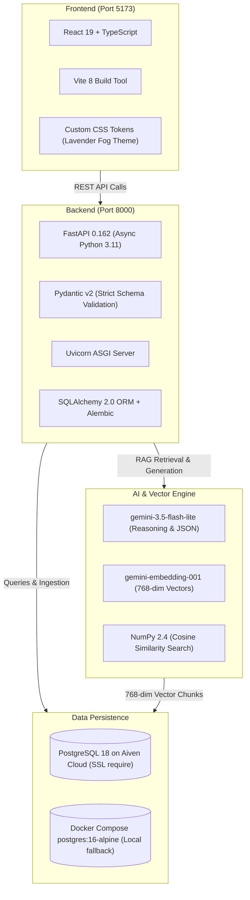

# MED-AI: Comprehensive Project Q&A & Architecture Reference Guide

**Project Code:** 27CSPS028  
**Official Project Title:** Reimagining Healthcare with Generative AI: Personalized Diagnosis and Treatment  
**System Name:** MED-AI  
**Domain:** Healthcare — Clinical Decision Support System (CDSS) for Outpatient / Primary Care  

---

## Table of Contents

1. [Part 1: Fundamental Project Overview Q&A](#part-1-fundamental-project-overview-qa)
2. [Part 2: Technology Stack & Component Justification ("What We Used & Why")](#part-2-technology-stack--component-justification-what-we-used--why)
3. [Part 3: The Three Core Modules Deep Dive](#part-3-the-three-core-modules-deep-dive)
4. [Part 4: Generative AI, RAG & Vector Search Q&A](#part-4-generative-ai-rag--vector-search-qa)
5. [Part 5: Multimodal Processing & Image Pipeline Q&A](#part-5-multimodal-processing--image-pipeline-qa)
6. [Part 6: Clinical Safety, Privacy & Ethical Safeguards](#part-6-clinical-safety-privacy--ethical-safeguards)
7. [Part 7: Database, Schema & Cloud Migrations](#part-7-database-schema--cloud-migrations)
8. [Part 8: Potential Viva & Presentation Defense Questions](#part-8-potential-viva--presentation-defense-questions)

---

## Part 1: Fundamental Project Overview Q&A

### Q1: What is MED-AI in simple terms?
**Answer:**  
MED-AI is an intelligent **Clinical Decision Support System (CDSS)** designed for outpatient and primary care clinicians. Instead of forcing a doctor to manually sift through scattered patient symptom notes, bedside monitor readings, paper lab reports, and radiology scans, MED-AI integrates all these multimodal inputs into one platform. It strips sensitive personal details for privacy, compares findings against **12 verified medical guidelines** (WHO, ICMR, NHS, NIH) using **Retrieval-Augmented Generation (RAG)**, and generates structured, plain-language clinical insights, differential considerations with citations, and follow-up discussion points.

### Q2: Does MED-AI replace doctors or prescribe medications?
**Answer:**  
**No, absolutely not.** MED-AI is strictly an assistive decision-support tool. It:
- **Never prescribes medicines** or gives clinical orders.
- **Never outputs definitive or autonomous diagnoses**; all diagnostic possibilities are framed as differential considerations for clinical investigation.
- Requires **mandatory human-in-the-loop oversight**: every diagnostic output remains in a `Pending Review` state until a licensed physician verifies the findings, documents their notes, and signs off.

### Q3: What problem in conventional healthcare does this project solve?
**Answer:**  
1. **Data Fragmentation:** Clinical data is siloed across handwritten notes, laboratory portals, vitals monitors, and PACS imaging systems.
2. **Cognitive Overload:** Primary care doctors often have only 5 to 10 minutes per patient to mentally synthesize diverse data points.
3. **Black-Box AI Risks:** Generic chatbots hallucinate medical advice and lack evidence grounding. MED-AI eliminates hallucinations by anchoring all reasoning to indexed medical guidelines via RAG and verifying citations.

---

## Part 2: Technology Stack & Component Justification ("What We Used & Why")



### Detailed Tool-by-Tool Breakdown

| Tool / Technology | Version / Specific Model | Exactly How We Used It | Why We Chose It Over Alternatives |
|---|---|---|---|
| **React** | `19.3.1` | Powers the single-page clinical dashboard: patient intake forms, interactive vitals strips, knowledge base management, and the multi-section diagnostic report viewer. | React 19 provides seamless state transitions, high reactivity for real-time validation warnings, and strong modular component architecture. |
| **TypeScript** | `7.0.2` | Defines strict clinical data types (`ClinicalAssessmentRecord`, `DiagnosticReportContent`, `FindingExplanation`, etc.) across all API contracts and UI components. | Healthcare software cannot tolerate runtime undefined errors; TypeScript enforces strict compile-time type safety. |
| **Vite** | `8.3.6` | Frontend bundler and local development server. | Sub-second Hot Module Replacement (HMR) and optimized ES-module production builds compared to legacy Webpack. |
| **FastAPI** | `0.162.2` | Core backend framework exposing RESTful endpoints for patient records, assessments, multimodal uploads, knowledge base indexing, and report generation. | Built-in asynchronous support (`async`/`await`), automatic OpenAPI/Swagger documentation (`/docs`), and native Pydantic validation. |
| **Pydantic** | `2.14.3` | Validates every incoming HTTP request payload and parses structured JSON responses from Gemini into strongly-typed Python objects. | High-performance C-based validation engine (`pydantic-core`) that ensures corrupted or malformed data is rejected before entering the database. |
| **SQLAlchemy** | `2.1.8` | Object-Relational Mapper (ORM) defining relational tables: `Patient`, `ClinicalAssessment`, `AssessmentAttachment`, `DiagnosticReport`, `KnowledgeDocument`, and `KnowledgeChunk`. | Python's gold-standard enterprise ORM; allows decoupled database migrations, connection pooling (`pool_pre_ping=True`), and relationship preloading (`joinedload`). |
| **psycopg3** | `3.3.8` (`psycopg[binary]`) | Low-level PostgreSQL driver connecting Python to PostgreSQL. | Modern asynchronous-ready PostgreSQL driver with full SSL/TLS support and binary protocol performance. |
| **Alembic** | `1.20.1` | Database migration engine managing incremental schema changes through versioned scripts in `database/migrations/versions/`. | Guarantees non-destructive, repeatable schema evolution across development, Docker, and cloud databases. |
| **PostgreSQL** | `PostgreSQL 18` | Hosted on **Aiven Cloud** (with SSL mode `require`) and local Docker Compose fallback (`postgres:16-alpine`). | ACID compliance, enterprise stability, relational joins between patients and assessments, and storage of vector chunk arrays. |
| **gemini-3.5-flash-lite** | Google GenAI SDK `3.1.0` | The primary reasoning LLM that consumes patient context + retrieved medical chunks + X-ray image bytes to output structured diagnostic reports. | Selected for sub-15-second latency, low token cost, multimodal image capability, and native structured JSON output enforcement (`response_mime_type="application/json"`). |
| **gemini-embedding-001** | Google GenAI SDK | Generates 768-dimensional dense vector embeddings for indexed medical guideline chunks and user search queries. | High semantic accuracy for clinical terminology and standardized 768-dim vector space. |
| **NumPy** | `2.4.6` | Computes cosine similarity matrices between the 768-dimensional query vector and all 291 stored guideline chunks in memory. | Vectorized dot-product and norm calculations in C execute in less than 5 milliseconds across hundreds of chunks without needing an external vector database. |
| **pypdf** | `7.0.1` | Extracts selectable clinical text from uploaded PDF medical documents (discharge notes, lab reports, EHR extracts). | Pure-Python, lightweight, and fast text extraction without external system dependencies like Poppler. |
| **Pillow (PIL)** | In standard image pipeline | Validates image formats (PNG/JPEG), checks dimensions, and strips camera, serial number, and GPS **EXIF metadata** before AI processing. | Guarantees patient privacy at the binary file level so device tracking metadata never leaves the server. |
| **Pytest & Vitest** | `pytest 9.2`, `vitest 5.1` | Automated test runners. Pytest tests all backend endpoints, PII redaction, and RAG retrieval (49 tests). Vitest tests all frontend forms, validation, and UI states (12 tests). | Guarantees complete regression prevention before production deployment. |

---

## Part 3: The Three Core Modules Deep Dive

### Module 1: Data Analysis and Preprocessing

#### Q4: What exact healthcare data categories does Module 1 collect?
**Answer:**  
Module 1 collects data across 8 distinct clinical categories:
1. **Demographics:** De-identified age, biological sex, patient ID.
2. **Symptoms & Duration:** Chief complaints and progression timeline.
3. **Medical History & Medications:** Pre-existing conditions, active drugs, and documented allergies.
4. **Clinical Measurements (Vitals):** Systolic & diastolic BP, heart rate, temperature, $\text{SpO}_2$.
5. **Laboratory Results:** Numerical and categorical values (WBC, CRP, blood glucose, $\text{HbA}_{1c}$, creatinine).
6. **Clinical Documents & Notes:** Scanned or exported PDF/TXT/JSON reports.
7. **Medical Images:** Chest X-rays (PNG/JPG).
8. **Optional Genomic Markers:** Hereditary notes or familial disease markers.

#### Q5: How does Module 1 preserve "Data Provenance"?
**Answer:**  
In medicine, *who* recorded a value matters greatly. Module 1 explicitly labels and preserves data sources so the AI and clinician know where each reading originated:
- `"Patient-reported symptoms: ..."` (subjective)
- `"Manually entered clinical measurements: ..."` (objective bedside reading)
- `"Laboratory results: ..."` (biochemical test)
- `"Extracted clinical document 'filename': ..."` (EHR / clinic note)
- `"Medical image attachments provided: ..."` (imaging asset)

#### Q6: How does missing-value validation work?
**Answer:**  
The system allows flexible entry because patients rarely know all their vitals. Broad technical bounds permit acute clinical readings (e.g., systolic BP 220 mmHg or heart rate 140 bpm) while triggering **non-blocking warnings** for clinician attention. Impossible physical values (e.g., negative pulse or temperature > 45°C) are rejected. If fields are omitted, the system records them as missing rather than assuming normal defaults.

---

### Module 2: Generative AI-Based Diagnosis

#### Q7: How does the AI analyze the patient data without hallucinating?
**Answer:**  
Through **Retrieval-Augmented Generation (RAG)**:
1. The backend builds a clinical search query from the patient's symptoms, vitals, and lab results.
2. It generates a 768-dimensional embedding vector of the query.
3. It performs cosine similarity search across 291 indexed guideline chunks in PostgreSQL.
4. The top matching chunks (from ICMR, WHO, NHS guidelines) are retrieved.
5. Gemini is prompted with both the patient's data and the retrieved guideline chunks enclosed in strict XML delimiters (`<UNTRUSTED_PATIENT_INPUT>` and `<UNTRUSTED_RETRIEVED_MEDICAL_CHUNKS>`).
6. Gemini is instructed: *"Cite ONLY exact chunk_id strings present in retrieved chunks. Never invent papers or citations."*

#### Q8: What is the structure of the generated Diagnostic Output?
**Answer:**  
The output is returned in a structured 9-section JSON schema:
- **01. Patient Context Summary:** Clear narrative summary of age, sex, primary symptoms, and key findings.
- **02. Clinical Findings:** Individual finding cards comparing recorded vitals to standard adult reference ranges, explaining what the measurement checks, whether it is inside or outside typical range, and why it matters clinically.
- **03. Diagnostic Considerations:** Differential patterns explaining what the condition means, why findings point here, what remains uncertain, and citing exact chunk IDs.
- **04. Clinical Limitations:** Transparent disclaimers regarding preliminary decision support.
- **05. Doctor Discussion Points:** Practical questions and physical tests to perform during consultation.
- **06. Treatment & Management Guidance:** Evidence-backed management steps (only provided if verified guidelines were retrieved).
- **07. Medical Image Observations:** Preliminary observations of uploaded X-rays.
- **08. Clinician Review & Approval:** Dedicated form for the doctor to type clinical notes and approve the report.

---

### Module 3: Decision Support and Privacy Safeguards

#### Q9: What happens if a patient enters life-threatening vitals (e.g., $\text{SpO}_2 < 90\%$)?
**Answer:**  
Before any AI model is even invoked, the **Emergency Red-Flag Interceptor** runs rule-based regex checks on the raw vitals and symptoms. If acute emergency indicators are detected (critical hypoxia $\text{SpO}_2 < 90\%$, severe chest pain, loss of consciousness, severe respiratory distress):
- An immediate high-visibility red banner is generated: *"CRITICAL EMERGENCY WARNING DETECTED"*.
- The prompt prioritizes emergency stabilization guidance over routine differential considerations.
- Routine follow-up questions are suppressed so emergency care is not delayed.

#### Q10: What is the "Evidence Withholding Policy"?
**Answer:**  
If a patient presents with symptoms or conditions for which our local knowledge base has no matching, verified medical guidelines (`sufficient_evidence == False`):
- The AI is **forbidden** from guessing treatment steps.
- The Treatment Guidance section displays: *"Treatment Guidance Withheld Due to Insufficient Verified Evidence. No verified medical guidelines in our knowledge base matched strongly enough to ground specific treatment steps."*
- This prevents AI from fabricating drug dosages or unverified therapies.

#### Q11: How is patient privacy protected before sending data to the AI?
**Answer:**  
1. **Text De-Identification:** Names, email addresses, 10-digit phone numbers, and exact dates of birth are scrubbed via regex before the prompt is constructed.
2. **Image EXIF Scrubbing:** The `image_processor` parses uploaded JPEG/PNG binaries and strips all EXIF chunks (`eXIf`, `tEXt`, `zTXt`, `iTXt`, `tIME`), removing camera serial numbers, timestamps, and GPS coordinates.
3. **Prompt Injection Defense:** Patient data is wrapped in `<UNTRUSTED_PATIENT_INPUT>` XML tags so malicious patient input cannot hijack the system instructions.

---

## Part 4: Generative AI, RAG & Vector Search Q&A

#### Q12: What medical documents are indexed in the knowledge base?
**Answer:**  
The knowledge base contains **12 official guideline documents** split into **291 vector chunks**:
- **Respiratory (5 docs):** ICMR Acute Respiratory Infections in Adults, ICMR Management of Respiratory Failure, ICMR COPD, ICMR Asthma, WHO Pulse Oximetry Home Monitoring.
- **Cardiovascular (2 docs):** ICMR Hypertension in Adults, ICMR STEMI / Acute Coronary Syndrome.
- **Diabetes & Endocrine (2 docs):** ICMR Type 2 Diabetes STW, NIH/NIDDK Diabetes Diagnosis Guidelines.
- **Laboratory (2 docs):** NHS Shropshire Point-of-Care CRP in Lower Respiratory Infections, NIH MedlinePlus WBC Test Guide.
- **General Clinical (1 doc):** WHO Interagency Integrated Triage Tool (Age $\ge$ 12).

#### Q13: Why did you use PostgreSQL + NumPy instead of Pinecone, ChromaDB, or Weaviate?
**Answer:**  
1. **Zero External Latency:** We store vectors directly in the relational PostgreSQL database (`knowledge_chunks` table), avoiding external cloud vector DB network overhead and recurring subscription costs.
2. **ACID Transactions:** When a document is deleted or updated, relational integrity ensures that all chunks and document records are cleanly added or deleted in one atomic transaction.
3. **Simplicity & Speed:** For our verified reference library (~300 to 5,000 chunks), NumPy computes dot-product cosine similarity in **less than 5 milliseconds** directly in memory.

#### Q14: Why did we upgrade from `gemini-3.1-flash-lite` to `gemini-3.5-flash-lite`?
**Answer:**  
Google's upstream servers experienced severe queue congestion on `gemini-3.1-flash-lite`, with single requests taking over 120 seconds. We upgraded to **`gemini-3.5-flash-lite`**, which is Google's newest lightweight model. It reduced end-to-end multimodal inference from ~120s down to **14 seconds** while maintaining high clinical reasoning accuracy and native JSON schema compliance.

---

## Part 5: Multimodal Processing & Image Pipeline Q&A

#### Q15: How does the system handle chest X-rays?
**Answer:**  
1. **Upload & Validation:** The user uploads a PNG or JPEG chest X-ray via `POST /api/v1/assessments/{id}/images`.
2. **Sanitization:** The `image_processor` verifies the image header, checks that dimensions are non-zero, validates that file size is under 10 MB, and strips all EXIF metadata.
3. **Persistence:** The cleaned image is saved in `backend/uploads/assessments/{id}/images/` with a unique UUID filename, and metadata is stored in `assessment_attachments`.
4. **Multimodal Inference:** During report generation, raw image bytes along with their MIME type (`image/png` or `image/jpeg`) are passed into `client.models.generate_content` as an `ImagePart`.
5. **Observation Generation:** Gemini inspects the image pixels alongside patient symptoms (e.g., crackles, fever) and produces **Section 07 (Medical Image Observations)**, detailing visible lung field opacities or cardiomegaly as preliminary decision support.

---

## Part 6: Clinical Safety, Privacy & Ethical Safeguards

#### Q16: How does the system prevent AI hallucinations in medical citations?
**Answer:**  
The backend executes a post-generation citation validation check:
```python
valid_id_set = {str(src.chunk_id) for src in verified_sources}
# Only keep citations that strictly match retrieved chunk UUIDs
cited_chunk_ids = [cid for cid in consideration.cited_chunk_ids if cid in valid_id_set]
```
If Gemini hallucinates a citation UUID that was not in the retrieved literature set, it is immediately discarded. If all citations in a consideration are invalid, the consideration is rejected or flagged.

#### Q17: How does the Clinician Review workflow function?
**Answer:**  
Every diagnostic report has three database fields:
- `clinician_reviewed: bool` (defaults to `False`)
- `clinician_notes: Optional[str]`
- `reviewed_at: Optional[datetime]`

In the UI, a **Clinician Review & Approval** card allows the practitioner to document their clinical impression, adjust suggested differentials, and click **Mark as Reviewed**. This updates the status across the dashboard, ensuring unreviewed AI outputs are never mistaken for completed clinical decisions.

---

## Part 7: Database, Schema & Cloud Migrations

#### Q18: What is the database schema structure?
**Answer:**  
The schema comprises 7 tables managed by Alembic (`20261112_0004`):
1. **`patients`:** Administrative patient records (`id`, `patient_code`, `full_name`, `date_of_birth`, `sex`, `contact_number`).
2. **`clinical_assessments`:** Individual clinical encounters (`patient_id`, symptoms, vitals, lab text, attachments metadata, clinician review status).
3. **`assessment_attachments`:** Stores metadata for uploaded clinical documents and chest X-rays (`kind`, `storage_path`, `mime_type`, `extraction_status`, `exif_stripped`).
4. **`diagnostic_reports`:** Stores AI-generated JSON reports linked to assessments (`provider`, `model_name`, `report_content` JSONB, review notes).
5. **`knowledge_documents`:** Metadata for reference guidelines (`title`, `source_name`, `file_hash`, `chunk_count`).
6. **`knowledge_chunks`:** Vector store chunks (`document_id`, `chunk_text`, `embedding_vector` array of 768 floats, `chunk_index`).
7. **`alembic_version`:** Migration state tracker.

#### Q19: Where is the database hosted, and how is it secured?
**Answer:**  
The database is hosted on **Aiven Cloud PostgreSQL 18**. It enforces encrypted transport via TLS/SSL (`sslmode=require`). We also maintain an identical local fallback container (`postgres:16-alpine`) in `docker-compose.yml` for offline development.

---

## Part 8: Potential Viva & Presentation Defense Questions

#### Q20: "Why Generative AI instead of a standard Machine Learning classifier (like Random Forest or XGBoost)?"
**Answer:**  
> *"Traditional ML classifiers are rigid and narrow: an XGBoost model can only predict a binary 0 or 1 for a single specific disease (like diabetes) based on predefined tabular columns. However, real-world clinical consultations involve unstructured stories: narrative symptoms, temporal durations, drug allergies, PDF reports, and X-ray images.*  
> *Generative AI acts as a **reasoning engine** that synthesizes all these modalities, compares them to clinical guidelines, and explains **why** a reading is abnormal in plain language. We also preserve ML models (like our XGBoost Pima diabetes experiment) as modular predictive references within the system."*

#### Q21: "What makes your RAG system reliable for medical use?"
**Answer:**  
> *"Three reasons:*  
> *1. **Strict Semantic Filtering:** Chunks must exceed a minimum cosine similarity threshold of 0.35 to be retrieved.*  
> *2. **Evidence Withholding:** If no verified medical guideline matches the patient's case, all treatment recommendations are withheld.*  
> *3. **Anti-Hallucination Verification:** The backend verifies every citation UUID cited by the LLM against the actual retrieved chunks before displaying it to the user."*

#### Q22: "How easy is it for someone else to run this project?"
**Answer:**  
> *"It is completely plug-and-play. Anyone who clones the repository simply pastes the `.env` file and double-clicks `setup.bat`. This automatically builds the Python environment, installs dependencies, runs database migrations, and installs npm packages. To start both the backend and frontend simultaneously, they simply double-click `start_app.bat`, which boots both servers and opens the browser automatically."*
