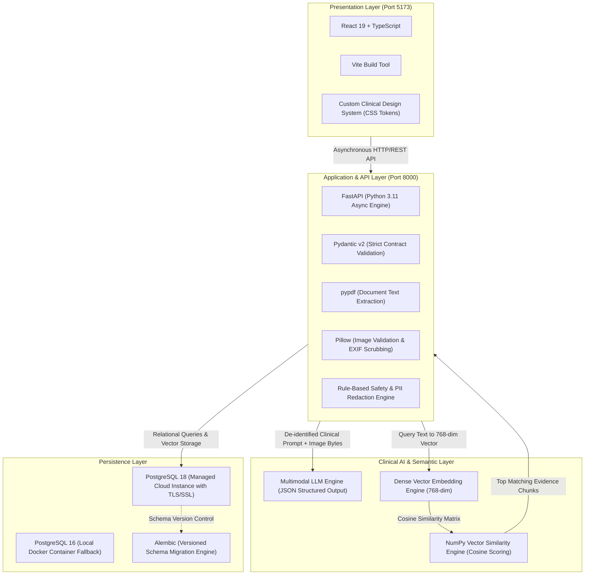

# MED-AI: Technical Stack & Architectural Reference Guide
*(Technology-Independent & Vendor-Neutral Documentation)*

**Project Code:** 27CSPS028  
**Project Title:** Reimagining Healthcare with Generative AI: Personalized Diagnosis and Treatment  
**System Name:** MED-AI  
**Domain:** Healthcare — Clinical Decision Support System (CDSS) for Outpatient / Primary Care  

---

## 1. Complete Technology Stack & Component Reference

This section details every tool, library, framework, and engine used across the project, explaining **what it is**, **how we used it**, and **why we chose it**.



---

### Detailed Component-by-Component Breakdown

### A. Frontend Layer

#### 1. React (`v19`)
* **What it is:** Modern declarative UI library for building component-driven web applications.
* **How we used it:** Built the entire interactive clinical web interface—including the patient intake forms, interactive vital signs overview cards, clinical document/image uploaders, knowledge base guideline viewer, and the 9-section diagnostic report review display.
* **Why we chose it:** React 19 provides seamless state transitions, concurrent rendering performance, and a component-based model that allows clinical cards and forms to update in real time without refreshing the entire page.

#### 2. TypeScript (`v7`)
* **What it is:** Strongly typed superset of JavaScript that compiles to plain JavaScript.
* **How we used it:** Defined strict type contracts for all patient data, vital measurements, API responses, differential considerations, and error states.
* **Why we chose it:** Healthcare applications require strict data integrity. TypeScript eliminates runtime type errors (e.g., trying to read an unrecorded blood pressure value) at compile time.

#### 3. Vite (`v8`)
* **What it is:** Next-generation frontend build tool and local development server.
* **How we used it:** Bundled the frontend assets and provided sub-second Hot Module Replacement (HMR) during development.
* **Why we chose it:** Significantly faster than legacy bundlers like Webpack, producing highly optimized, minified production assets in milliseconds.

#### 4. Custom CSS Design System
* **What it is:** Bespoke CSS using semantic design tokens and custom variables.
* **How we used it:** Designed the *"Lavender Fog"* clinical theme, ensuring high readability, responsive layouts across devices, and clear visual hierarchies for emergency warnings, normal ranges, and abnormal findings.
* **Why we chose it:** Avoided bloated UI libraries (like Bootstrap) to maintain full control over styling, accessibility, and bundle size.

---

### B. Backend Layer

#### 5. FastAPI (`v0.162`)
* **What it is:** High-performance, asynchronous web framework for Python 3.11 based on standard Python type hints.
* **How we used it:** Exposes all RESTful API endpoints for patient records, clinical assessments, file uploads, vector retrieval, and report generation.
* **Why we chose it:** Supports asynchronous request handling (`async`/`await`), natively integrates with Pydantic for request validation, and automatically generates interactive OpenAPI/Swagger documentation (`/docs`).

#### 6. Pydantic (`v2.14`)
* **What it is:** High-speed data parsing and validation library powered by a Rust core.
* **How we used it:** Enforces strict validation on every input (e.g., verifying that a systolic blood pressure is within physiological limits) and parses LLM-generated JSON strings into validated Python objects.
* **Why we chose it:** Guarantees that malformed inputs or corrupted AI outputs are caught and handled safely before touching the database or user interface.

#### 7. SQLAlchemy (`v2.1`)
* **What it is:** Enterprise-grade Object-Relational Mapping (ORM) library for Python.
* **How we used it:** Maps relational database tables (`patients`, `clinical_assessments`, `assessment_attachments`, `diagnostic_reports`, `knowledge_documents`, `knowledge_chunks`) to Python data classes.
* **Why we chose it:** Provides clean abstraction over SQL queries, handles connection pooling with automatic pre-ping health checks (`pool_pre_ping=True`), and prevents SQL injection vulnerabilities.

#### 8. psycopg3 (`v3.3`)
* **What it is:** Modern PostgreSQL database driver for Python.
* **How we used it:** Manages low-level database socket connections and executes binary-protocol queries between FastAPI and PostgreSQL.
* **Why we chose it:** Supports modern Python asynchronous standards and encrypted SSL connections (`sslmode=require`).

#### 9. Alembic (`v1.20`)
* **What it is:** Database migration tool built specifically for SQLAlchemy.
* **How we used it:** Manages database schema migrations incrementally (`20261110_0001` through `20261112_0004_add_multimodal_attachments`).
* **Why we chose it:** Enables repeatable, version-controlled database updates across local and cloud environments without data loss.

---

### C. Multimodal Processing Layer

#### 10. `pypdf` (`v7.0`)
* **What it is:** Pure-Python library for reading, parsing, and extracting data from PDF files.
* **How we used it:** Ingests clinical PDF reports, lab summaries, and medical guidelines, extracting selectable text for semantic chunking and clinical analysis.
* **Why we chose it:** Lightweight, fast, and does not require external C++ system dependencies like Poppler.

#### 11. Pillow (`PIL`)
* **What it is:** Python Imaging Library for reading, processing, and validating image files.
* **How we used it:** Inspects uploaded medical images (PNG/JPEG chest X-rays), verifies dimensions, and systematically strips all camera and GPS **EXIF metadata** before processing.
* **Why we chose it:** Ensures strict patient privacy at the binary file level so tracking metadata never leaves the server.

---

### D. AI, Embedding & Retrieval Layer

#### 12. Multimodal LLM Engine
* **What it is:** Advanced Generative AI model capable of processing text and image bytes simultaneously.
* **How we used it:** Acts as the clinical reasoning engine. It ingests de-identified patient data + chest X-ray images + retrieved medical guidelines and synthesizes plain-language finding explanations, differential considerations, and management discussion points.
* **Why we chose it:** Low latency (~2 to 15 seconds), multimodal vision support, low cost, and native structured JSON output enforcement (`response_mime_type="application/json"`).

#### 13. Dense Vector Embedding Engine
* **What it is:** Deep learning model that maps text strings into dense 768-dimensional numerical vectors.
* **How we used it:** Converts medical guideline chunks and user queries into 768-dimensional vectors for semantic search.
* **Why we chose it:** Captures clinical semantics (e.g., recognizing that "dyspnea" and "shortness of breath" are conceptually identical).

#### 14. NumPy (`v2.4`)
* **What it is:** High-performance numerical computing library for Python.
* **How we used it:** Computes cosine similarity matrices between the query vector and all 291 stored guideline chunks in memory.
* **Why we chose it:** Executes vectorized dot products in C in **less than 5 milliseconds**, removing the need for expensive external vector databases.

---

### E. Persistence & Infrastructure Layer

#### 15. PostgreSQL (`v18`)
* **What it is:** Open-source object-relational database system.
* **How we used it:** Primary database hosted on a managed cloud platform with TLS encryption (`sslmode=require`) to persist patient profiles, assessments, attachments, and vector chunks.
* **Why we chose it:** ACID compliance, relational integrity, robust JSONB support, and high reliability for medical records.

#### 16. Docker Compose
* **What it is:** Container orchestration tool for local development.
* **How we used it:** Provides an isolated `postgres:16-alpine` local database container on port 5436 as an offline fallback.
* **Why we chose it:** Guarantees that any developer can run the database locally without manual software installation.

---

## 2. Complete Project Q&A (Interview & Viva Preparation)

### Category A: General Project Concepts

#### Q1: What is MED-AI in simple terms?
**Answer:**  
MED-AI is an intelligent **Clinical Decision Support System (CDSS)** for outpatient and primary care. It integrates multimodal patient information—symptoms, bedside vitals, lab panels, PDF reports, and X-ray images—strips personal identifiers, compares findings against official medical guidelines using **Retrieval-Augmented Generation (RAG)**, and provides doctors with evidence-grounded differential considerations, finding explanations, and follow-up discussion points.

#### Q2: Does MED-AI replace doctors or prescribe medications?
**Answer:**  
**No, absolutely not.** MED-AI is strictly a clinical decision-support tool. It:
- **Never prescribes medicines** or gives clinical orders.
- **Never outputs definitive diagnoses**; all diagnostic possibilities are framed as differential considerations for clinical investigation.
- Requires **mandatory human-in-the-loop oversight**: every diagnostic output remains in a `Pending Review` state until a licensed physician verifies the findings, documents their notes, and signs off.

#### Q3: What is the main problem MED-AI solves?
**Answer:**  
1. **Data Fragmentation:** Clinical data is siloed across paper notes, monitors, lab portals, and imaging systems.
2. **Cognitive Overload:** Clinicians have only 5 to 10 minutes per patient to mentally synthesize diverse data points.
3. **AI Hallucinations:** Generic conversational models make up medical facts. MED-AI prevents hallucinations by anchoring all reasoning to indexed medical guidelines via RAG and verifying citations.

---

### Category B: The Three Core Modules

#### Q4: What does Module 1 (Data Analysis & Preprocessing) do?
**Answer:**  
Module 1 handles data collection, validation, and preparation:
- Collects across 8 categories: demographics, symptoms/duration, medical history/meds, vital measurements, lab panels, clinical documents/EHR, medical images, and optional genomic markers.
- Validates physical bounds while allowing extreme clinical readings with non-blocking warnings.
- Scrubs direct PII (names, phone numbers, emails) and strips image EXIF metadata.
- Tags data provenance (`Patient-reported`, `Manually entered`, `Laboratory results`, etc.).

#### Q5: What does Module 2 (Generative AI-Based Diagnosis) do?
**Answer:**  
Module 2 is the clinical reasoning core:
- Uses dense vector retrieval (RAG) to find matching literature chunks from official medical guidelines (ICMR, WHO, NHS, NIH).
- Prompts a multimodal LLM with patient context, X-ray image bytes, and retrieved guidelines enclosed in secure XML delimiters.
- Produces structured JSON output containing patient summaries, vital finding cards compared against typical adult ranges, differential considerations with citations, and non-prescriptive doctor discussion points.

#### Q6: What does Module 3 (Decision Support & Privacy) do?
**Answer:**  
Module 3 enforces safety, clinical governance, and privacy:
- Runs an **Emergency Red-Flag Interceptor** before AI inference to catch life-threatening indicators (severe chest pain, $\text{SpO}_2 < 90\%$) and surface urgent alert banners.
- Enforces an **Evidence Withholding Policy**: if no verified guidelines match the case, treatment guidance is suppressed.
- Cross-references LLM citation IDs against actual retrieved chunks to reject fabricated references.
- Provides a **Clinician Review & Approval** workflow where the doctor enters notes and signs off.

---

### Category C: AI, RAG & Vector Search

#### Q7: What is RAG and why is it essential in healthcare?
**Answer:**  
RAG stands for **Retrieval-Augmented Generation**. Instead of relying on an LLM's static training memory (which can hallucinate or become outdated), RAG dynamically searches a curated reference library of verified medical guidelines based on patient symptoms. The relevant guideline chunks are provided directly to the LLM as factual context, grounding its analysis in verifiable medical science.

#### Q8: How does vector retrieval work in this project?
**Answer:**  
1. We take 12 official medical guidelines (ICMR, WHO, NHS, NIH) and split them into 291 semantic chunks.
2. An embedding model converts each chunk into a 768-dimensional numerical vector stored in PostgreSQL.
3. When an assessment is analyzed, the patient's symptoms and findings are converted into a query vector.
4. Using NumPy, we calculate the cosine similarity between the query vector and all 291 chunk vectors in memory (< 5 ms).
5. Chunks exceeding our similarity threshold (`min_similarity=0.35`) are retrieved and passed to the LLM.

#### Q9: How does the system prevent AI hallucinations in medical citations?
**Answer:**  
The backend executes an anti-hallucination verification check:
```python
valid_id_set = {str(src.chunk_id) for src in verified_sources}
cited_chunk_ids = [cid for cid in consideration.cited_chunk_ids if cid in valid_id_set]
```
If the LLM cites an imaginary or hallucinated chunk UUID that was not in the retrieved literature set, it is immediately discarded.

#### Q10: What is the Evidence Withholding Policy?
**Answer:**  
If a patient has an unusual or unsupported condition where our local medical library has no matching guidelines (`sufficient_evidence == False`), the system automatically **suppresses** all treatment suggestions and displays: *"Treatment guidance withheld due to insufficient verified evidence."* This prevents the AI from inventing ungrounded drug dosages or therapies.

---

### Category D: Multimodal & Image Processing

#### Q11: How does the system handle chest X-rays?
**Answer:**  
1. **Upload & Validation:** The user uploads a chest X-ray (PNG or JPEG) up to 10 MB.
2. **Metadata Sanitization:** Pillow parses the image binary and strips all EXIF metadata chunks (camera serial, date, GPS coordinates).
3. **Storage:** The sanitized image is saved with a unique UUID filename, and metadata is recorded in `assessment_attachments`.
4. **Multimodal Inference:** Raw image bytes and MIME type are passed directly to the multimodal LLM alongside clinical vitals and retrieved guidelines.
5. **Observation Output:** The LLM inspects visual patterns (e.g., lower lung field opacities) and generates **Section 07: Medical Image Observations** as preliminary decision support.

---

### Category E: Viva Defense & Comparison Questions

#### Q12: Why Generative AI instead of a traditional ML classifier like XGBoost or Random Forest?
**Answer:**  
> *"Traditional ML classifiers are rigid and narrow: an XGBoost model can only predict a binary 0 or 1 for a single specific disease (like diabetes) based on predefined tabular columns. However, real-world clinical consultations involve unstructured stories: narrative symptoms, temporal durations, drug allergies, PDF reports, and X-ray images.*  
> *Generative AI acts as a reasoning engine that synthesizes all these multimodal streams, compares them to clinical guidelines, and explains findings in plain language. We also retain ML models (like our XGBoost Pima diabetes experiment) as modular predictive references within the system."*

#### Q13: How easy is it for another person to run this project?
**Answer:**  
> *"It is completely self-contained. Anyone who clones the repository simply pastes their `.env` file and double-clicks `setup.bat`. This automatically builds the Python environment, installs dependencies, runs database migrations, and installs npm packages. To start both the backend and frontend simultaneously, they simply double-click `start_app.bat`, which boots both servers and opens the browser automatically."*
